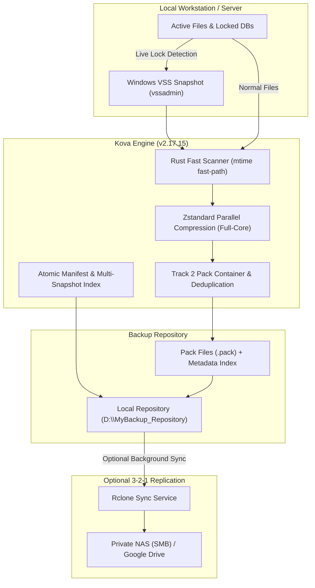

# Kova (v2.17.15)
> **Local-First Windows Backup & Instant Disaster Recovery Engine**

[](https://github.com/kks3365550/Kova/releases)
[](https://microsoft.com/windows)
[](LICENSE)
[](#architecture-overview)
[](#installation--deployment)

**Kova** is a high-performance, deterministic Windows backup orchestration and disaster recovery system. Built for developer workstations, production PCs, and on-premises Windows servers, Kova delivers instantaneous incremental snapshots, crash-consistent containerized storage, and seamless bare-metal disaster recovery without external cloud dependencies.

---

## 📑 Table of Contents

- [Key Highlights](#-key-highlights)
- [Architecture Overview](#-architecture-overview)
- [Core Features](#-core-features)
  - [1. High-Speed Incremental Engine (Rust + Python)](#1-high-speed-incremental-engine-rust--python)
  - [2. Track 2 Pack Container & Crash-Consistent Storage](#2-track-2-pack-container--crash-consistent-storage)
  - [3. Zero-Lock Live Backups via Windows VSS](#3-zero-lock-live-backups-via-windows-vss)
  - [4. Ghost / Silent Background Execution](#4-ghost--silent-background-execution)
  - [5. 3-2-1 Offsite Replication & Cloud Encryption](#5-3-2-1-offsite-replication--cloud-encryption)
  - [6. Granular & Bare-Metal Recovery](#6-granular--bare-metal-recovery)
- [Installation & Deployment](#-installation--deployment)
  - [Method 1: Windows Installer (Inno Setup)](#method-1-windows-installer-inno-setup)
  - [Method 2: Windows Package Manager (winget)](#method-2-windows-package-manager-winget)
  - [Method 3: Portable / Developer Setup](#method-3-portable--developer-setup)
- [Web Management Dashboard](#-web-management-dashboard)
- [CLI Reference](#-cli-reference)
- [Security & Encryption Architecture](#-security--encryption-architecture)
- [License](#-license)

---

## ⚡ Key Highlights

- **Local-First & Air-Gapped Ready**: Operates 100% on-premises with zero telemetry. Repository stays on your local NVMe/SSD, secondary disk, or private NAS.
- **Hybrid Core Engine**: Leverages a compiled Rust binary (`engine_rust`) for microsecond metadata scanning and multithreaded Zstandard compression (`threads=-1`), coordinated by Python core management.
- **Windows-Native Integration**: Full support for Volume Shadow Copy Service (VSS), Windows Image Bare-Metal Backup (`wbadmin`), Windows Task Scheduler, and System Tray (`tray_app.py`).
- **Zero Console Window Flickering**: Background scheduled tasks execute invisibly via VBScript/`CREATE_NO_WINDOW` wrappers without popping up CMD windows.
- **Deterministic Crash Consistency**: Pack container architecture with atomic journals, SHA-256 integrity verification, and automatic transaction rollback on sudden power loss.

---

## 🏗️ Architecture Overview



---

## 🛡️ Core Features

### 1. High-Speed Incremental Engine (Rust + Python)
- **mtime Fast-Path Scan**: Bypasses heavy full-file re-reading for unchanged files by comparing metadata cache against current disk states.
- **5ms Timestamp Tolerance & Index Union**: Prevents false modified/new file alerts caused by FAT32/NTFS microsecond rounding differences.
- **Full-Core Multithreading**: Utilizes all available CPU cores for Zstandard chunk compression without throttling disk NVMe throughput.

### 2. Track 2 Pack Container & Crash-Consistent Storage
- **Pack Ingestion**: Small files and chunk streams are packed into contiguous container files to minimize filesystem inode/file-handle fragmentation.
- **Power Loss Self-Healing**: Write-Ahead Logging (WAL) and atomic journal commits prevent repository corruption if power cuts out mid-backup.

### 3. Zero-Lock Live Backups via Windows VSS
- Files actively locked by databases, SQLite WALs, running IDEs, or Microsoft Office are captured cleanly via native Windows VSS snapshots without terminating user processes.

### 4. Ghost / Silent Background Execution
- Scheduled backups run invisibly using `start_silent.vbs` or `pythonw.exe`. No black command prompt windows pop up to disrupt active gaming or workflow sessions.

### 5. 3-2-1 Offsite Replication & Cloud Encryption
- **3-2-1 Compliance**: Mirrors snapshots to a secondary destination (private NAS via SMB/NFS, or cloud destinations like Google Drive via `rclone`).
- **Transport Security**: All remote communications to Google Drive or WebDAV endpoints are encrypted via TLS 1.3 / HTTPS.
- **Clean Ingestion Filter**: Transient runtime locks (`backup.lock`) and temp buffers are strictly filtered out; remote chunk pruning (`prune_storage`) maintains cloud parity.
- **Native At-Rest Encryption Engine (`core/crypto_at_rest.py`)**:
  - Kova features a built-in envelope encryption engine. When enabled with a master passphrase, all local data blobs are encrypted with **AES-256-GCM** using Scrypt key derivation (32-byte key, 16-byte salt, random 12-byte nonce, authenticated tag) under the `ENC\x01` binary container.
  - When offsite replication is active, these locally encrypted blobs are synced to the cloud in their already-encrypted ciphertext form.
- **Cloud Remote Encryption Layer (`rclone crypt`)**:
  - Alternatively, if local backups remain unencrypted for maximum deduplication but cloud copies must be zero-knowledge, users can configure an **rclone `crypt` overlay remote** (`rclone config` -> `crypt`).
  - Rclone crypt transparently secures file contents using **XSalsa20-Poly1305** authenticated encryption and obfuscates file/directory names using **AES-EME** before data leaves the workstation.

### 6. Granular & Bare-Metal Recovery
- **Snapshot Time Machine**: Browse filesystem states at any historical snapshot point.
- **Selective Restore**: Restore individual files, directories, or entire volume roots.
- **Standalone Emergency Kit**: `emergency_restore/` contains standalone scripts and offline tools to restore files even if the main Kova installation or Python environment is damaged.

---

## 🚀 Installation & Deployment

### Method 1: Windows Installer (Inno Setup)
The recommended deployment method for standard Windows PCs:
1. Download `Kova_Setup_v2.17.15.exe` from [GitHub Releases](https://github.com/kks3365550/Kova/releases).
2. Run the installer. It bundles an embedded CPython runtime, so no prior Python installation is required.
3. The installer automatically terminates any previous instances, registers the background service, and creates Desktop/Start Menu shortcuts.

### Method 2: Windows Package Manager (winget)
```powershell
# Install via winget (Official package submission: microsoft/winget-pkgs#450485)
winget install kks3365550.BackupSystem
```

### Method 3: Portable / Developer Setup
Clone the repository and run directly:
```powershell
# 1. Clone repository
git clone https://github.com/kks3365550/Kova.git
cd Kova

# 2. Set up virtual environment
python -m venv .venv
.\.venv\Scripts\Activate.ps1
pip install -r requirements.txt

# 3. Launch Web Dashboard
python run.py
```

---

## 🖥️ Web Management Dashboard

Kova includes a local web management dashboard accessible at:
```text
http://localhost:8765
```

- **Real-Time SSE Streaming**: Live progress bars, transfer throughput (MB/s), and real-time logs via Server-Sent Events.
- **Interactive File Explorer**: Explore snapshot trees and download individual files directly in the browser.
- **Profile Manager**: Configure backup sources, retention policies (daily/weekly/monthly), compression levels, and excluded patterns.
- **System Health & Storage Metrics**: Monitor repository storage consumption, deduplication ratios, and offsite sync status.

---

## 💻 CLI Reference

Kova can be managed fully from the terminal:

```powershell
# Run immediate backup using the default profile
python cli.py backup

# Run backup with a specific profile
python cli.py backup --profile prof_default

# List all available snapshots
python cli.py list

# Verify repository integrity
python cli.py verify

# Restore a specific snapshot to target directory
python cli.py restore <snapshot_id> --target C:\Restore_Target
```

---

## 🔒 Security & Encryption Architecture

- **Zero-Cloud Air-Gapped by Default**: All backups and catalog databases stay strictly on-premises. Zero phone-home requests, zero telemetry.
- **Root Trust Anchor**: Update payloads and self-extracting release bundles are cryptographically verified using active **Ed25519 v2 public key signatures** (`keys/release_ed25519_v2.pub`). Legacy v1 signatures are rejected.
- **Credential Isolation**: Master password hashes, session salts, and OAuth tokens are stored exclusively in local untracked files (`data/auth_config.json`, `data/app_settings.json`) and ignored by git (`.gitignore`).
- **Native At-Rest & Cloud Encryption**: Local repository encryption via **AES-256-GCM** with **Scrypt KDF** (`core/crypto_at_rest.py`), plus optional cloud zero-knowledge encryption via rclone `crypt` using **XSalsa20-Poly1305** (data) and **AES-EME** (filenames).

---

## 📄 License

This project is licensed under the **MIT License**. See the [LICENSE](LICENSE) file for details.
